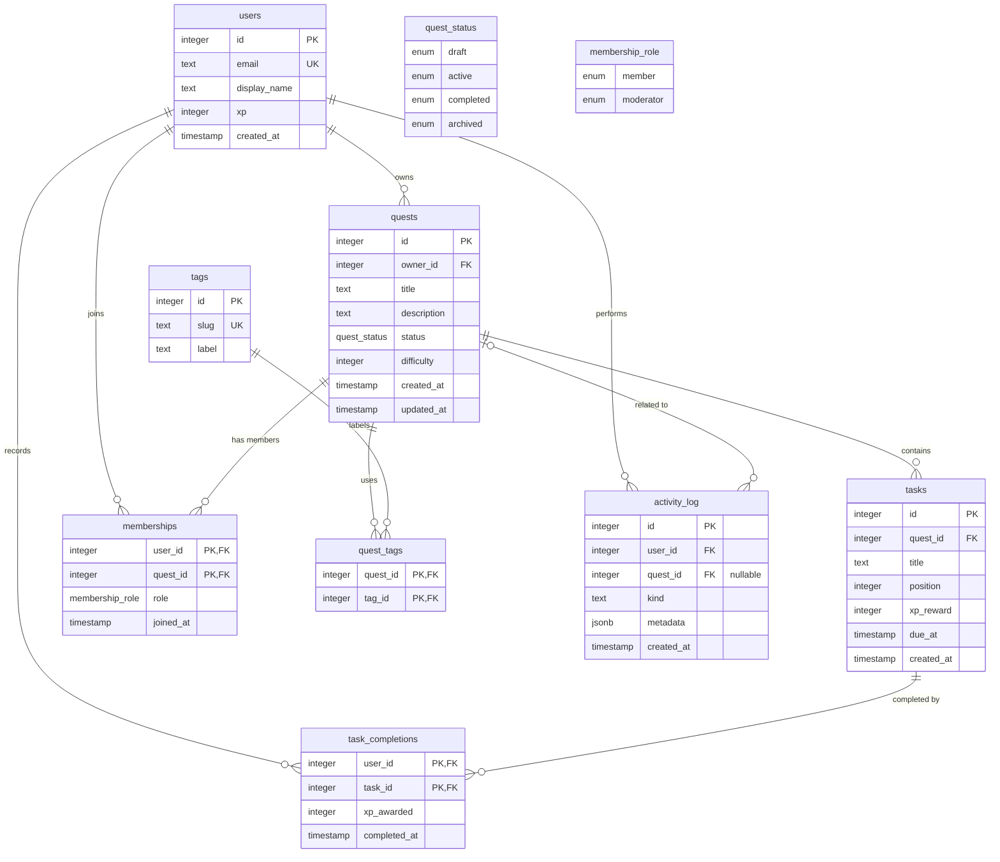

# Drizzel Learning Quest

A Next.js learning project for a quest and task-tracking application backed by PostgreSQL and Drizzle ORM.

## Tech Stack

- **[Next.js](https://nextjs.org/)** - Application framework
- **[Drizzle ORM](https://orm.drizzle.team/)** - TypeScript ORM and migrations
- **[PostgreSQL](https://www.postgresql.org/)** with `pg` - Database
- **[Zod](https://zod.dev/)** - Schema validation
- **[Dotenv](https://www.npmjs.com/package/dotenv)** - Environment variable management
- **[Prettier](https://prettier.io/)** - Code formatting

## Getting Started

Install dependencies and start the development server:

```bash
pnpm install
pnpm dev
```

Open [http://localhost:3000](http://localhost:3000) with your browser to see the result.

## Local Development

Start PostgreSQL locally with Docker:

```
docker run --name questboard-postgres -e POSTGRES_USER=postgres -e POSTGRES_PASSWORD=postgres -e POSTGRES_DB=questboard -p 54331:5432 -d postgres:18-alpine
```

## Database Management

The database schema is defined in `db/schema.ts` and migrations are stored in `drizzle/`:

- `pnpm run db:generate` - Generate SQL migration files from schema changes.
- `pnpm run db:migrate` - Run pending migrations against the database.
- `pnpm run db:check` - Check for schema mismatches.
- `pnpm run db:studio` - Launch Drizzle Studio, a visual database explorer.
- `pnpm run db:push` - Push schema changes directly to the database for rapid prototyping.

## Code Formatting

Prettier is configured for the application and project configuration files:

- `pnpm run format` - Format the project files.
- `pnpm run format:check` - Check formatting without changing files.

## Database Structure


